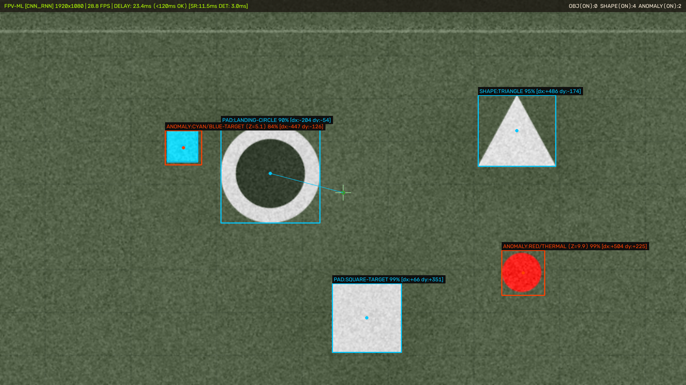

# ISDC 27 — Real-Time FPV Drone ML Video Enhancer, Multi-Modal Detector & QGroundControl Hub

End-to-end real-time Computer Vision, Deep Learning Super-Resolution (`CNN + Temporal RNN`), Multi-Modal Object/Shape/Color-Anomaly Detection (`YOLOv8n + Geometric Fiducials + CIE LAB Spectral Saliency`), and Zero-Latency H.264 RTP Video Streamer into **QGroundControl**, paired with a **Multi-Laptop D-Link LAN MAVLink Telemetry Router**.



---

## 1. Repository Structure

| File | Description |
| :--- | :--- |
| [`pipeline.py`](pipeline.py) | Main real-time video capture $\rightarrow$ CNN+RNN enhancement $\rightarrow$ YOLO/Shape/Color-Anomaly detection $\rightarrow$ H.264 RTP/MPEG-TS UDP streamer to QGroundControl (`UDP 5600`). |
| [`enhancer.py`](enhancer.py) | **Motion-Gated Temporal Recurrent Denoiser (Conv-RNN state)** + **CIE LAB CLAHE Dynamic Range Recovery** + **ESPCN $2\times$ Sub-Pixel Super-Resolution CNN**. |
| [`detector.py`](detector.py) | **Multi-Modal Real-Time Detector** running:<br>1. **YOLOv8n Object Detection** (`models/yolov8n.onnx` via asynchronous ONNX Runtime worker)<br>2. **Geometric Shape & Landing Pad Detector** (Circle/Square Landing Pads, Triangles, Rectangles, Hexagons + boresight guidance error vector $\Delta x, \Delta y$)<br>3. **Spectral Color Abnormality Detector** (CIE LAB Mahalanobis/Z-score background outlier map + HSV thermal/hazard signatures) |
| [`streamer.py`](streamer.py) | Zero-latency baseline H.264 RTP (`pt=96`) and MPEG-TS UDP streamer (`127.0.0.1:5600` or remote LAN IPs) compatible out-of-the-box with QGroundControl. |
| [`capture.py`](capture.py) | Threaded lock-free V4L2 USB capture card reader, **Dual-Camera Side-by-Side / Picture-in-Picture Multiplexer** (replaces 2 OBS windows), and **Synthetic Analog 5.8 GHz FPV Simulator**. |
| [`mavlink_hub.py`](mavlink_hub.py) | Multi-laptop D-Link LAN MAVLink Telemetry Router that reads Pixhawk telemetry (`/dev/ttyUSB0` or `/dev/ttyACM0`) and forwards role-specific telemetry to static laptop IPs. |
| [`models_arch.py`](models_arch.py) & [`train_enhancer.py`](train_enhancer.py) | ESPCN Sub-Pixel CNN architecture, ONNX graph builder (`models/fpv_espcn_x2.onnx`), and train/test PSNR evaluation script. |

---

## 2. Installation & Setup

```bash
cd ~/ISDC_27
python3 -m venv .venv
./.venv/bin/pip install -r requirements.txt
```

### Configure QGroundControl Video Receiver (One-Time Setup)
1. Launch QGroundControl:
   ```bash
   ~/Downloads/QGroundControl.AppImage
   ```
2. Click the **QGC Logo (top-left)** $\rightarrow$ **Application Settings** $\rightarrow$ **General** $\rightarrow$ scroll to **Video**:
   - **Video Source**: Select **`UDP h.264 Video Stream`**
   - **UDP Port**: **`5600`**

---

## 3. Running the Pipeline

### A. Test Immediately with the Built-In Analog 5.8 GHz FPV Simulator
```bash
cd ~/ISDC_27
./.venv/bin/python pipeline.py --source sim --split-view --preview
```
- **Interactive Preview Hotkeys**:
  - `v`: Toggle Raw vs. Enhanced split-screen comparison
  - `e`: Cycle enhancement mode (`cnn_rnn` $\rightarrow$ `fast_hybrid` $\rightarrow$ `passthrough`)
  - `y`: Toggle YOLOv8n object detection
  - `s`: Toggle geometric shape & landing pad detection
  - `c`: Toggle spectral color abnormality detection
  - `1` / `2` / `b`: Switch between Camera 1, Camera 2, or Both (Side-by-Side)
  - `q`: Quit

### B. Run Live on Zeus VTX 800mW USB Video Capture Card(s)
- **Single FPV Camera** (`/dev/video0`):
  ```bash
  ./.venv/bin/python pipeline.py --source /dev/video0
  ```
- **Dual FPV Cameras Simultaneously inside QGroundControl** (`/dev/video0` + `/dev/video2`, Side-by-Side or Picture-in-Picture):
  ```bash
  ./.venv/bin/python pipeline.py --source /dev/video0 --source2 /dev/video2 --dual-mode sbs
  ```
- **Stream Across D-Link Switch to Camera Station Laptop (`192.168.1.30:5600`)**:
  ```bash
  ./.venv/bin/python pipeline.py --source /dev/video0 --source2 /dev/video2 \
      --udp-host 127.0.0.1 --udp-port 5600 --extra-targets 192.168.1.30:5600
  ```

### C. Run Multi-Laptop D-Link LAN MAVLink Telemetry Hub
```bash
./.venv/bin/python mavlink_hub.py --master /dev/ttyUSB0 --baud 57600 \
    --flight-ip 192.168.1.10:14550 \
    --payload-ip 192.168.1.20:14550 \
    --camera-ip 192.168.1.30:14550 \
    --filter-roles
```
